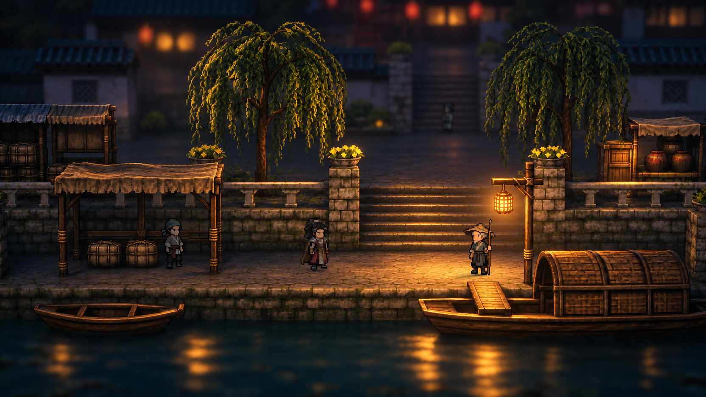
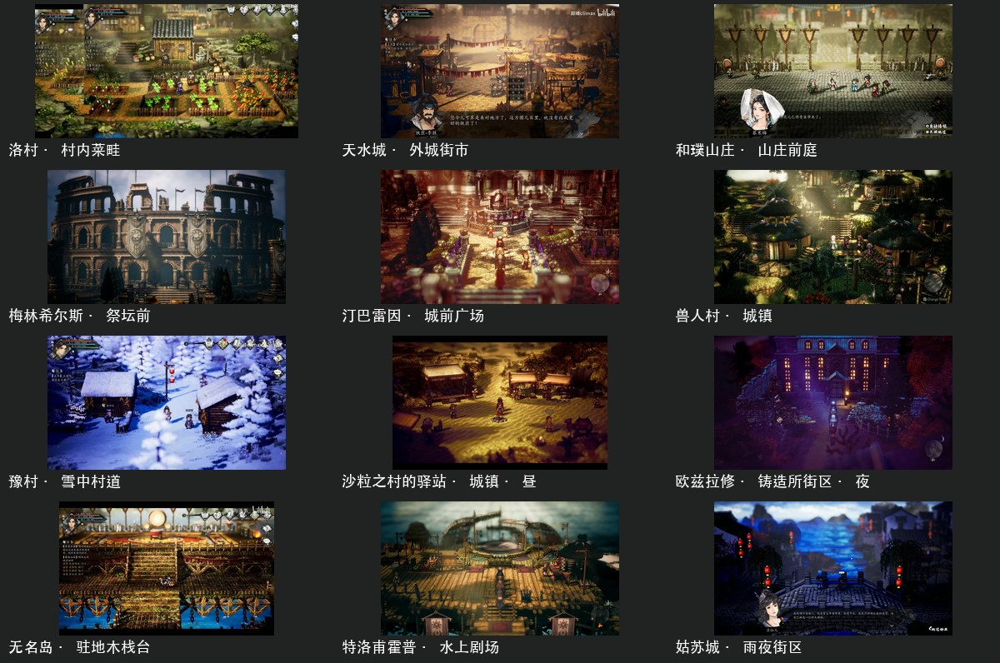

# HD-2D 实机图工作流

默认生成武侠场景。只有明确指定西幻题材时才进入[独立西幻工作流](references/西幻实机图.md)，使用该流程的建筑和人物参考。

新武侠场景从[皇城、姑苏、边城、竹林的十二张定稿](references/武侠四地定稿/选图与光照.md)选一张完整画幅，校准跑图距离、像素人物比例、景深和光向，再从[双游戏场景图库](references/atlas/README.md)选地点和材质。[光源局部对照](references/武侠四地定稿/光源方向局部对照.jpg)可放大检查宫门阴影、树隙夕照与月光落桥。批量出图先完成一张样张。下方柳荫渡口演示同一底图的三时段。

| 正午 | 黄昏 | 夜晚 |
|:---:|:---:|:---:|
| [](examples/柳荫渡口/01_正午.png) | [](examples/柳荫渡口/02_黄昏.png) | [](examples/柳荫渡口/03_夜晚.png) |

## 在 Codex 中使用

下载或克隆整个仓库，将含有 `SKILL.md` 的仓库根目录作为 `hd2d-gameplay-stills` 放入 Codex 技能目录。默认位置是 `~/.codex/skills/hd2d-gameplay-stills/`；自定义了 `CODEX_HOME` 时，安装到其 `skills/` 下。新开一个 Codex 会话即可点名使用。也可以在仓库目录中直接指定 [SKILL.md](SKILL.md)。

直接在克隆的仓库里可以这样提问：

```text
用[HD2D 实机图工作流](./SKILL.md) 生成同一座雪山驿站的正午、黄昏、夜晚三张实机效果图。按场景安排人物，三张保持同一机位。
```

安装为技能后也可以直接用 `$hd2d-gameplay-stills` 点名调用。

生成新的环境或角色需要 Codex 会话提供图像生成功能。使用随包 PNG 本地合成只需 Python 3、FFmpeg 和 ffprobe。从仓库根目录运行以下命令，即可在 `renders/` 中得到一张示例图。脚本会创建输出目录，并保留已有的同名图。

```sh
python3 scripts/place_yuwen.py 'assets/渡口·正午无人底图.png' 'renders/正午-宇文逸.png' \
  --height 124 --feet 752 638 --face right \
  --tint .86 .87 .77 --lit-tint 1.23 1.14 .93 --shadow-x 4
```

## 按用途查找

| 想做什么 | 从哪里开始 |
|---|---|
| 找地貌、城镇或职业场所的原作画面 | [按场景挑图与全部地点](references/atlas/README.md) · [离线地图索引](references/atlas/地图索引.html) · [逐图来源](references/atlas/图源与覆盖.json) |
| 看像素、景深或光照细节 | [79 地高清取景索引](references/hd/README.md) · [待补地点与机位](references/hd/待补画面.md) |
| 换地点，生成自己的场景 | [技能入口](SKILL.md) · [中文主提示词与按场景排人的模板](references/出图主提示词.md) |
| 按渡口修订案重新出图 | [实际英文提示词和每次附图的顺序](examples/柳荫渡口/生图提示词.md) · [三张成图与生成底图](examples/柳荫渡口/) |
| 将所需人物放回场景 | [渡口实例的站位与合成命令](references/柳荫渡口复盘.md) · [透明人物和底图](assets/) |
| 对照已生成效果图的光照与景深 | [工作流六景总览](references/visuals/昼暮夜六景.jpg) · [早期六景补光词](references/六景原始补光词.txt) |
| 验证人物、店门与家具的比例 | [同倍率茶铺对照](examples/姑苏河街/人物与茶铺比例.jpg) · [试站量法与复核命令](references/局部区域与随镜用光.md#人物和建筑怎样定尺) |
| 制作二期局部区域、布置城镇昼暮夜灯光、表现玩家随镜受光 | [区域尺寸、双方法与静态取景示例](references/局部区域与随镜用光.md) |
| 校准新武侠场景的用光与轻景深 | [鼓楼市街定稿、焦带图与复现命令](examples/鼓楼市街/用光与焦带.md) |
| 将景深应用到新机位的垂帘、屏风、枝叶等遮挡物 | [按物体划分焦带与验图](SKILL.md#按物体划分焦带) |

## 工作流维护

每次升级或优化本工作流，在源码仓库核对变更与引用的素材，验证受影响的脚本或样例，提交到 [GitHub 仓库](https://github.com/xiaoniubaiwei910515/hd2d-gameplay-stills-skills) 的 `main` 分支，同步本机技能安装副本。交付时回读 GitHub 的 `refs/heads/main`，核对远端、源码与安装副本的提交和实际文件。该约定适用于工作流维护，日常出图按当次委托的交付范围处理。

## 参考素材

完整收录本地整理的两款游戏城镇与室外场景图集，涵盖**《逸剑风云决》53 个地点、《八方旅人Ⅱ》26 个地点**。在 393 张原图册图片之外，新增 [162 张原始尺寸实机参考](references/hd/README.md)，其中《八方旅人Ⅱ》26 地均有 3840×2160 原图。两作共有 68 地具备至少一张达到 1920×1080 的单幅实机图。其余 11 地的最佳尺寸和未补齐的同角度街段见[待补画面](references/hd/待补画面.md)。原图册含可直接附给生成器的实景、用于看布局的拼接街段，以及地点总览、方位图和世界地图。点击下图可按村落、闹市、门派、雪地、沙漠、矿场、海港等题材选图，再查看各张图的来源。

[](references/atlas/README.md)

人物随玩法和场所安排。空镜可无人，封闭的山路可只出现主角，集市可安排摊主、客人和搬货的人群。渡口实例中的船夫、伙计和行人只对应那一幕。用户指定人数、身份或空镜时，以委托为准。

宇文逸的原图及透明站姿用于校准 NPC 的像素尺寸。渡口的环境、NPC 和三张成图是工作流示例；游戏截图和人物参考保留各自来源。
