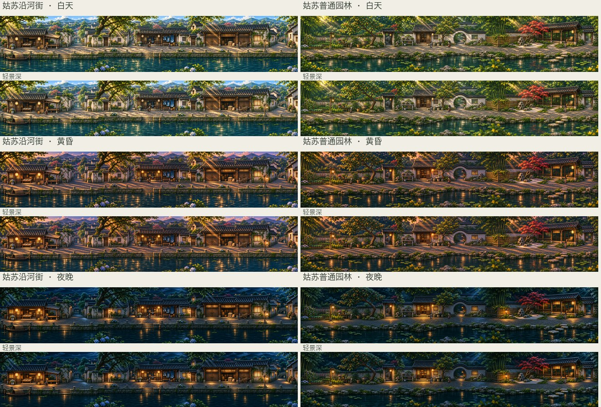

# 二期案例 · 姑苏沿河街与普通园林

这两处场景的正常版已经用户认可，作为二期局部拼接的参考。沿河街从鱼行经布庄到米行，普通园林从花圃经月洞门到东廊。两区都是横向三屏，每屏 1600 × 900，全幅 4800 × 900。轻景深版根据树冠虚实不连续、玩家近处过虚的反馈修订，使用与对应正常版相同的机位、人物和照明。



| 区域 | 时段 | 开发参考 | 修订的特效参考 |
|---|---|---|---|
| 姑苏沿河街 | 白天 | [正常版](完整区域/姑苏沿河街-白天-正常版.png) | [轻景深版](完整区域/姑苏沿河街-白天-轻景深版.png) |
| 姑苏沿河街 | 黄昏 | [正常版](完整区域/姑苏沿河街-黄昏-正常版.png) | [轻景深版](完整区域/姑苏沿河街-黄昏-轻景深版.png) |
| 姑苏沿河街 | 夜晚 | [正常版](完整区域/姑苏沿河街-夜晚-正常版.png) | [轻景深版](完整区域/姑苏沿河街-夜晚-轻景深版.png) |
| 姑苏普通园林 | 白天 | [正常版](完整区域/姑苏普通园林-白天-正常版.png) | [轻景深版](完整区域/姑苏普通园林-白天-轻景深版.png) |
| 姑苏普通园林 | 黄昏 | [正常版](完整区域/姑苏普通园林-黄昏-正常版.png) | [轻景深版](完整区域/姑苏普通园林-黄昏-轻景深版.png) |
| 姑苏普通园林 | 夜晚 | [正常版](完整区域/姑苏普通园林-夜晚-正常版.png) | [轻景深版](完整区域/姑苏普通园林-夜晚-轻景深版.png) |

## 在实图上检查焦点

打开[同位置局部对照](树与近处物件-景深对照.jpg)，从左到右依次为正常版、原轻景深与修订轻景深。园林中间的桂树与玩家站在同一片园路旁，从花叶沿枝条往下看，主枝、树干都保留细节。东段红枫与西段枇杷依各自的栽植位置定焦。河街的榆枝有一致的轻微柔化，透过叶隙能看到更软的远屋。布庄近处的檐口和瓦棱与铺前活动区相接。远山、门内竹径、河面近端和贴镜植物依各自的距离保留虚化。

先确定树根与人物是否站在相近的地面，再在同一树冠上、中、下和通向树干的一根枝分别取样。河街中屏榆树三个样点在原焦带上分别约为 2.99、1.95、3.43 px，修订后均约为 0.48 px。园林桂树的树梢、中枝和树干原来约为 3.33、2.19、0 px，修订后这三处均保留正常版原像素。以上是本机位按焦带权重折算的半径。隔着叶隙的远屋、透过月洞门的竹径分别取自身深度。

## 重现六张轻景深

随包提供两张全尺寸灰度焦带。[沿河街](焦带/姑苏沿河街.png) · [普通园林](焦带/姑苏普通园林.png)。需要 Python、NumPy 和 Pillow。在仓库根目录可以这样复现园林白天。

```sh
python3 scripts/render_focus.py 'examples/二期姑苏两景/完整区域/姑苏普通园林-白天-正常版.png' 'renders/姑苏普通园林-白天-轻景深版.png' --focus-map 'examples/二期姑苏两景/焦带/姑苏普通园林.png' --radius 4.4
```

另外五张替换区域名和时段即可。六组的世界坐标 x=2360…2439、y=382…514 覆盖主角和脚边，正式 PNG 在这个范围内逐像素一致。检查近物时仍须沿主角可走区域向两侧看同层的家具、树冠和屋面。换场景时，按新画面的植物遮挡、门洞与水岸重画焦带。
