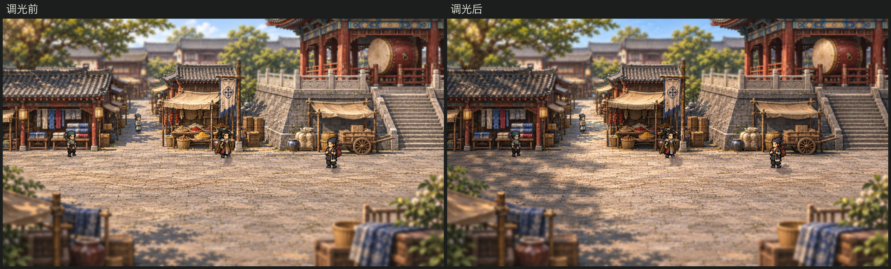

# 鼓楼市街白天 · 用光与焦带

用户认可的 1600 × 900 武侠单屏样张。[调光正常版](白天·正常版.png)用于对照环境与人物受光。[轻景深定稿](白天·轻景深.png)用于核对近远过渡。下图左、右两版使用相同的焦带和 4.4 像素最大半径。



## 布光和验图

整条街由左上日光照亮，阴影承接较冷的天光和周围地面的反光。把亮暗落到具体物体上看：

1. 从棚顶看进香料摊。上表面受光，布沿、货架、筐内逐层入暗。收住人物脸旁的筐沿和罐口高光，仍能辨出货物。
2. 从布铺走到巷口。树冠投下的阴影跨过铺前街面，在巷口至主角脚边留出连续的受光石路。更换地点时，按实际通路与遮挡重排这段明暗。
3. 对齐小人与实景。树影中的伙计吃到天光，街上的主角与脚夫迎光侧稍暖，靴底贴地，投影同邻近立柱一起伸向右下。鼓面和阶沿接光，檐内和台阶立面较暗。

看[库国白昼城街](../../references/hd/八方旅人Ⅱ/库国/白昼城街.jpg)的摊前亮路与近处桥栏，再看[平康街边店铺](../../references/hd/逸剑风云决/平康城/街边店铺.jpg)的棚影和人物落影。Acquire 说明二代以动态昼夜照明配合 Sequencer 切换时段。[二代开发访谈](https://www.unrealengine.com/developer-interviews/octopath-traveler-ii-builds-a-bigger-bolder-world-in-its-stunning-hd-2d-style?lang=en)

吴迪在 CiGA 分享中说明，《逸剑风云决》的 2D 角色和 3D 植被按太阳角度实时投影，并用景深与大气雾表现纵深。这里用共同光向、环境色和局部遮挡在静态图中重建这种观感。[吴迪演讲整理](https://www.sohu.com/a/829045180_204824)

## 从正常版复现

在仓库根目录运行：

```sh
python3 scripts/render_focus.py 'examples/鼓楼市街/白天·正常版.png' 'renders/鼓楼白天-轻景深.png' \
  --focus-map 'examples/鼓楼市街/焦带.png' --radius 4.4
```

[焦带图](焦带.png)对应这一个机位。主角和脚下为黑色，横街两侧为深灰，前景布棚和后排屋顶按空间深度过渡。其他地点按本景的通路、遮挡和物件轮廓重画。同一机位改光时沿用同一焦带、人物层位置与半径，分别从调光前后的正常版导出，再等宽并排；在原尺寸核对焦内像素和投影，在缩图核对路口与地标是否仍可辨。

旧版径向效果可显式传入 `--strength 1` 复现，900 像素高时对应 14.4 像素。已保存的旧版 `--matte` 用作径向过渡区调节，新机位的完整灰度焦带使用 `--focus-map`。
