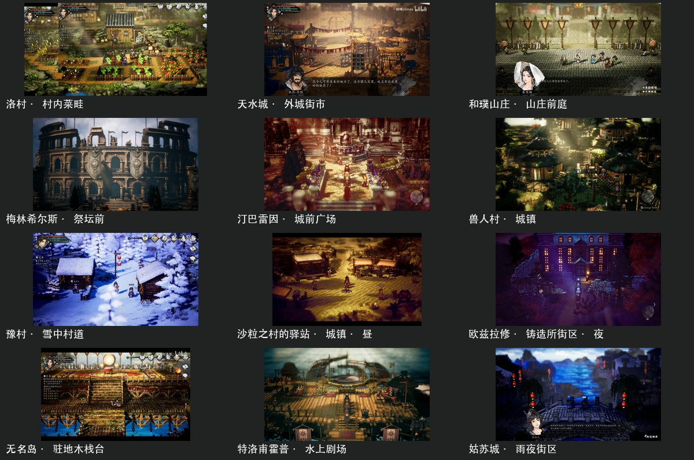

# 双游戏场景参考图库

收录《逸剑风云决》53 个地点与《八方旅人Ⅱ》26 个地点。原图集的 393 张图片均可在克隆后离线打开。其中有 117 张实景原图与实机截帧、121 张街段拼接、79 张地点总览、73 张方位图和 3 张世界地图。两款作品的具体地点、帧尺寸、拼接来源和外部图源见[图源与覆盖清单](图源与覆盖.json)。本地可直接在浏览器打开[原版地图索引](地图索引.html)。

高清原图与新增角度见[79 地高清取景索引](../hd/README.md)。[待补画面](../hd/待补画面.md)列出仍缺全高清的地点及原图册各街段的输入尺寸。

## 按场景挑参考

先从符合委托的一行打开实景，再从另一地点补一个具体问题，例如雪地反光或摊棚遮挡。图集总览和世界地图用于查位置，角色面部用原尺寸像素帧。同机位换时段时沿用空间底图，换用与光源条件相近的光照参考。

| 场景 | 可直接打开的画面 | 观察什么 |
|---|---|---|
| 村落与田间 | [洛村 · 村内菜畦](逸剑风云决/城镇/洛村/拼接/村内菜畦-街段.png) · [程家村 · 村舍与田间小路](逸剑风云决/城镇/程家村/拼接/村舍与田间小路.png) | 观察村舍之间的小路、屋檐和田畦。 |
| 市集与节庆 | [天水城 · 外城街市](逸剑风云决/城镇/天水城/街景/外城街市.jpg) · [姑苏城 · 灯会](逸剑风云决/城镇/姑苏城/街景/灯会.jpg) · [威尔格罗布 · 城镇](八方旅人Ⅱ/城镇/威尔格罗布/街景/城镇-实景.jpg) | 观察摊位密度、横向通行带、摊灯与建筑的前后关系。 |
| 府衙与练武场 | [六扇门 · 府衙前庭](逸剑风云决/城镇/六扇门/街景/府衙前庭.jpg) · [和璞山庄 · 山庄前庭](逸剑风云决/城镇/和璞山庄/街景/山庄前庭-1080p.jpg) · [武当派 · 山门广场](逸剑风云决/城镇/武当派/拼接/山门广场-wudang-1.png) | 观察门前台阶、院落尺度、演武空间和对称轴。 |
| 山寺与祭坛 | [少林寺 · 街景](逸剑风云决/城镇/少林寺/街景/街景.jpg) · [梅林希尔斯 · 祭坛前](八方旅人Ⅱ/城镇/梅林希尔斯/街景/祭坛前-实景.jpg) · [弗拉姆教堂村 · 大圣堂入口](八方旅人Ⅱ/城镇/弗拉姆教堂村/街景/大圣堂入口-实景.jpg) | 观察入口层次、通往建筑的仪式路线和沿途留白。 |
| 城关与广场 | [峋谷关 · 街景](逸剑风云决/城镇/峋谷关/街景/街景.jpg) · [库国 · 库城入口](八方旅人Ⅱ/城镇/库国/街景/库城入口-实景.jpg) · [汀巴雷因 · 城前广场](八方旅人Ⅱ/城镇/汀巴雷因/街景/城前广场-实景.jpg) | 观察门洞、台阶和街面衔接，确定守门和过路的位置。 |
| 林间与山麓遗址 | [无人村 · 城镇](八方旅人Ⅱ/城镇/无人村/街景/城镇-实景.jpg) · [兽人村 · 城镇](八方旅人Ⅱ/城镇/兽人村/街景/城镇-实景.jpg) · [天山派遗址 · 遗址入口一带的山麓墓碑](逸剑风云决/城镇/天山派遗址/街景/山麓墓碑与遗址入口.jpg) | 观察林冠、石壁、土路与遮挡，用空地控制探索节奏。 |
| 雪村与冰城 | [豫村 · 雪中村道](逸剑风云决/城镇/豫村/街景/雪中村道.jpg) · [斯托姆黑伊鲁 · 桥上](八方旅人Ⅱ/城镇/斯托姆黑伊鲁/街景/桥上-实景.jpg) · [凛芬镇 · 盗贼街 · 昼](八方旅人Ⅱ/城镇/凛芬镇/街景/盗贼街-昼.jpg) | 观察雪面反光、岩石阴影、木屋与积雪桥面的明度差。 |
| 沙漠与驿站 | [塞伊 · 东区](八方旅人Ⅱ/城镇/塞伊/街景/东区-实景.jpg) · [沙粒之村的驿站 · 城镇 · 昼](八方旅人Ⅱ/城镇/沙粒之村的驿站/街景/城镇-昼.jpg) · [沙粒之村的驿站 · 城镇 · 夜](八方旅人Ⅱ/城镇/沙粒之村的驿站/街景/城镇-夜.jpg) | 观察干燥地表的暖冷交界、低矮屋群和夜间的局部光源。 |
| 工厂与矿场 | [轮敦 · 工厂街 · 夜](八方旅人Ⅱ/城镇/轮敦/街景/工厂街-夜.jpg) · [欧兹拉修 · 铸造所街区 · 夜](八方旅人Ⅱ/城镇/欧兹拉修/街景/铸造所街区-夜.jpg) · [弗里吉特监狱岛 · 采矿场](八方旅人Ⅱ/城镇/弗里吉特监狱岛/街景/采矿场-实景.jpg) | 观察厂房剪影、金属轮廓、作业通道及灯火在烟尘中的落点。 |
| 海岛、港口与水上建筑 | [无名岛 · 驻地木栈台](逸剑风云决/城镇/无名岛/街景/驻地木栈台.jpg) · [特洛甫霍普 · 水上剧场](八方旅人Ⅱ/城镇/特洛甫霍普/街景/水上剧场-实景.jpg) · [康宁湾 · 港口](八方旅人Ⅱ/城镇/康宁湾/街景/港口-实景.jpg) | 观察岸线、栈桥、船体和平台之间的高差与水面反光。 |
| 雨夜与街巷 | [姑苏城 · 雨夜街区](逸剑风云决/城镇/姑苏城/街景/雨夜街区-1080p.jpg) · [名剑山庄 · 黄昏](逸剑风云决/城镇/名剑山庄/街景/黄昏.jpg) · [新德尔斯塔 · 城镇 · 夜](八方旅人Ⅱ/城镇/新德尔斯塔/街景/城镇-夜.jpg) | 观察湿地反光、店面进深，以及同地点昼夜光源的替换。 |
| 室内厅堂与客栈 | [客栈窗火 · 工作流效果图](../visuals/夜晚·客栈窗火.png) | 看柜台、前梁、窗光与地板之间的关系。馆藏以室外城镇、门派和村落为主。洞窟、地牢深处等缺少对应实景时，另选同类参考并注明来源。 |

拼接图可观察路线和空间连续性，部分街段来自 480p 视频，细纹与五官请用单帧核对。原图可能保留 HUD、标注或对话框，生成画面时仅采用约定的构图、材质或光照。每个地点有各自的已收录范围。

## 全部地点

点击地名可进入该地点的街景、总览及已收录的拼接或方位图。

### 逸剑风云决 · 53 处

- [梧桐村](逸剑风云决/城镇/梧桐村/) · [洛村](逸剑风云决/城镇/洛村/) · [平康城](逸剑风云决/城镇/平康城/) · [武当派](逸剑风云决/城镇/武当派/) · [清河村](逸剑风云决/城镇/清河村/) · [千陵渡](逸剑风云决/城镇/千陵渡/) · [六扇门](逸剑风云决/城镇/六扇门/) · [天剑宗](逸剑风云决/城镇/天剑宗/)
- [阎浮镇](逸剑风云决/城镇/阎浮镇/) · [少林寺](逸剑风云决/城镇/少林寺/) · [青木舫](逸剑风云决/城镇/青木舫/) · [姑苏城](逸剑风云决/城镇/姑苏城/) · [名剑山庄](逸剑风云决/城镇/名剑山庄/) · [威远镖局](逸剑风云决/城镇/威远镖局/) · [双河村](逸剑风云决/城镇/双河村/) · [雷家村](逸剑风云决/城镇/雷家村/)
- [谭城](逸剑风云决/城镇/谭城/) · [丐帮总舵](逸剑风云决/城镇/丐帮总舵/) · [天鸣村](逸剑风云决/城镇/天鸣村/) · [幽云泽渡口](逸剑风云决/城镇/幽云泽渡口/) · [南渝村](逸剑风云决/城镇/南渝村/) · [津鲤村](逸剑风云决/城镇/津鲤村/) · [程家村](逸剑风云决/城镇/程家村/) · [北山村](逸剑风云决/城镇/北山村/)
- [峋谷关](逸剑风云决/城镇/峋谷关/) · [辽城](逸剑风云决/城镇/辽城/) · [黎城](逸剑风云决/城镇/黎城/) · [临昌](逸剑风云决/城镇/临昌/) · [玄火教](逸剑风云决/城镇/玄火教/) · [豫村](逸剑风云决/城镇/豫村/) · [樊城](逸剑风云决/城镇/樊城/) · [苍岚村](逸剑风云决/城镇/苍岚村/)
- [神鹰门](逸剑风云决/城镇/神鹰门/) · [穷山据点](逸剑风云决/城镇/穷山据点/) · [苦水村](逸剑风云决/城镇/苦水村/) · [天水城](逸剑风云决/城镇/天水城/) · [甘泉村](逸剑风云决/城镇/甘泉村/) · [平阳堡](逸剑风云决/城镇/平阳堡/) · [恶人谷](逸剑风云决/城镇/恶人谷/) · [景陇](逸剑风云决/城镇/景陇/)
- [霹雳门](逸剑风云决/城镇/霹雳门/) · [蝴蝶村](逸剑风云决/城镇/蝴蝶村/) · [洱郡](逸剑风云决/城镇/洱郡/) · [石屏村](逸剑风云决/城镇/石屏村/) · [五仙教](逸剑风云决/城镇/五仙教/) · [碧波门](逸剑风云决/城镇/碧波门/) · [长生殿](逸剑风云决/城镇/长生殿/) · [仙人渡](逸剑风云决/城镇/仙人渡/)
- [游仙村](逸剑风云决/城镇/游仙村/) · [程家堡](逸剑风云决/城镇/程家堡/) · [和璞山庄](逸剑风云决/城镇/和璞山庄/) · [无名岛](逸剑风云决/城镇/无名岛/) · [天山派遗址](逸剑风云决/城镇/天山派遗址/)

### 八方旅人Ⅱ · 26 处

- [无人村](八方旅人Ⅱ/城镇/无人村/) · [兽人村](八方旅人Ⅱ/城镇/兽人村/) · [卡纳尔布来因](八方旅人Ⅱ/城镇/卡纳尔布来因/) · [寒岬村](八方旅人Ⅱ/城镇/寒岬村/) · [轮敦](八方旅人Ⅱ/城镇/轮敦/) · [康宁湾](八方旅人Ⅱ/城镇/康宁湾/) · [克拉克雷吉](八方旅人Ⅱ/城镇/克拉克雷吉/) · [库罗普提尔](八方旅人Ⅱ/城镇/库罗普提尔/)
- [弗拉姆教堂村](八方旅人Ⅱ/城镇/弗拉姆教堂村/) · [格拉维尔](八方旅人Ⅱ/城镇/格拉维尔/) · [库国](八方旅人Ⅱ/城镇/库国/) · [遗种镇](八方旅人Ⅱ/城镇/遗种镇/) · [梅林希尔斯](八方旅人Ⅱ/城镇/梅林希尔斯/) · [蒙特维斯](八方旅人Ⅱ/城镇/蒙特维斯/) · [无名之乡](八方旅人Ⅱ/城镇/无名之乡/) · [新德尔斯塔](八方旅人Ⅱ/城镇/新德尔斯塔/)
- [欧兹拉修](八方旅人Ⅱ/城镇/欧兹拉修/) · [洛克岛](八方旅人Ⅱ/城镇/洛克岛/) · [沙粒之村的驿站](八方旅人Ⅱ/城镇/沙粒之村的驿站/) · [塞伊](八方旅人Ⅱ/城镇/塞伊/) · [斯托姆黑伊鲁](八方旅人Ⅱ/城镇/斯托姆黑伊鲁/) · [汀巴雷因](八方旅人Ⅱ/城镇/汀巴雷因/) · [特洛甫霍普](八方旅人Ⅱ/城镇/特洛甫霍普/) · [威尔格罗布](八方旅人Ⅱ/城镇/威尔格罗布/)
- [凛芬镇](八方旅人Ⅱ/城镇/凛芬镇/) · [弗里吉特监狱岛](八方旅人Ⅱ/城镇/弗里吉特监狱岛/)

世界地图用于定位地点。[江湖](逸剑风云决/世界地图/江湖世界地图.png) · [索里苏提亚](八方旅人Ⅱ/世界地图/索里苏提亚.jpg) · [索里苏提亚 · 26处城镇定位](八方旅人Ⅱ/世界地图/索里苏提亚-城镇定位.jpg)
