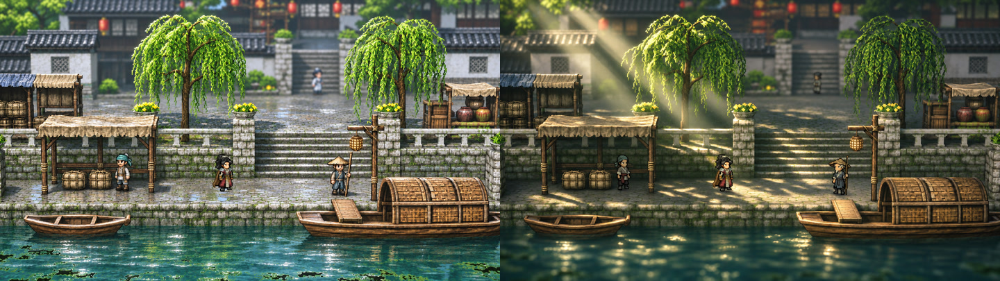

# 柳荫渡口三时段复盘

初版从同一张渡口底图分别生成正午、黄昏和夜晚，再把同一帧宇文逸放回石岸。两艘船、台阶、灯架和主角站位可以逐一对照。反馈集中在正午光线平、全景过于清晰，以及路人五官比主角精细。



| 看什么 | 初版的问题 | 修订时实际怎么做 |
|---|---|---|
| 日光 | 石面和瓦片都亮，柳下缺少可以追踪的光路 | 用高位日光穿过左柳，湿气和背后的暗墙衬出光束。亮斑落到石岸和台阶踏面，棚下和台阶立面保留冷影。 |
| 景深 | 前景水纹、中景石缝和远景屋瓦争夺注意力 | 对照[千陵渡实机](visuals/千陵渡·实机.jpg)的跑图距离与[卡纳尔布来因实机](visuals/卡纳尔布来因·白昼实机.jpg)的对焦。近水反光柔成小片，中景保留眼睛、石缝和跳板边，远瓦减弱纹理，远窗留柔边。 |
| NPC | 底图自带的船夫、伙计都有较圆且细密的五官，仅校准身高仍与主角画风不同 | 移走底图中的三名路人及船篙。参照宇文逸原帧重做三张透明站姿，三个时段复用。伙计仍戴青头巾，船夫仍握篙，后阶行人随远处建筑一起柔化。 |
| 角色受光 | 统一调色难以同时表现棚下的脸、灯旁的斗笠和远处的白衣 | 按各自站位分配环境色、受光侧和投影方向。一次试合成在高亮皮肤出现青绿色点，将输出 RGB 各通道限制在 0 到 255 后复查脸部和手部。 |

缩图先看日光能否一路追到地面。再用原尺寸[三时段人物局部](visuals/渡口人物·三时段局部.png)比较眼睛占格、帽檐台阶和衣褶，最后来回切换三幅核对地标和脚底。这两种看图尺寸分别能发现光照太平和人物画风不一致。

## 用随包素材试合成

下面的参数只对应这幅 **1664 × 936** 的[正午无人底图](../assets/渡口·正午无人底图.png)。复用到其他地点时，先按相邻 NPC、门槛或柜台校准人物大小，再定脚底。手持道具随人物入画，灯杆等固定设施在底图里。透明帧以原始朝左图的鞋底作锚点，镜像后由脚本换算。

| 人物与透明帧 | 脚底坐标 | 成图尺寸的依据 |
|---|---|---|
| [后阶行人](../assets/渡口·后阶行人.png) | 1056, 311 | 在后阶，以远处门洞校准，随背景柔化 |
| [左棚伙计](../assets/渡口·左棚伙计.png) | 408, 632 | 在棚下，按宇文逸的头肩校准，脸部用较弱的天光 |
| [宇文逸](../assets/宇文逸·来图站姿.png) | 752, 638 | 可见身高约 124 像素，朝右 |
| [撑篙船夫](../assets/渡口·撑篙船夫.png) | 1128, 648 | 脚靠近跳板，校准身高时扣除帽尖以上的篙头 |

从技能目录运行以下示例。最后一条输出完整正午场景。每一步保留上一步已经落位的角色，遮挡用的前景层放到最后。改为黄昏或夜晚时更换同机位无人底图，复用四人的尺寸、朝向和锚点，重新取人物各自位置的环境色和光向。

```sh
cast_work=$(mktemp -d "${TMPDIR:-/tmp}/hd2d-ferry.XXXXXX")
python3 scripts/place_yuwen.py assets/渡口·正午无人底图.png "$cast_work/1.png" \
  --sprite assets/渡口·后阶行人.png --frame-height 78 --anchor 11 49 --feet 1056 311 \
  --face left --tint .48 .53 .52 --lit-tint .74 .75 .65 --soften 2.3
python3 scripts/place_yuwen.py "$cast_work/1.png" "$cast_work/2.png" \
  --sprite assets/渡口·左棚伙计.png --frame-height 129 --anchor 12 49 --feet 408 632 \
  --face right --tint .55 .61 .61 --lit-tint .82 .82 .70 --shadow-x 2
python3 scripts/place_yuwen.py "$cast_work/2.png" "$cast_work/3.png" \
  --height 124 --feet 752 638 --face right --tint .86 .87 .77 --lit-tint 1.23 1.14 .93 --shadow-x 4
python3 scripts/place_yuwen.py "$cast_work/3.png" "$cast_work/渡口正午.png" \
  --sprite assets/渡口·撑篙船夫.png --frame-height 143 --anchor 16 52 --feet 1128 648 \
  --face left --tint .72 .80 .76 --lit-tint 1.04 1.01 .84 --shadow-x 4
```

夜渡时可在船夫这一步传入 `--light-from right` 和偏暖的 `--lit-tint`，让靠灯的一侧受光。中景角色保留近邻采样出的像素格。远景角色按实际距离使用 `--soften`，脚底始终按同一个锚点对齐。
