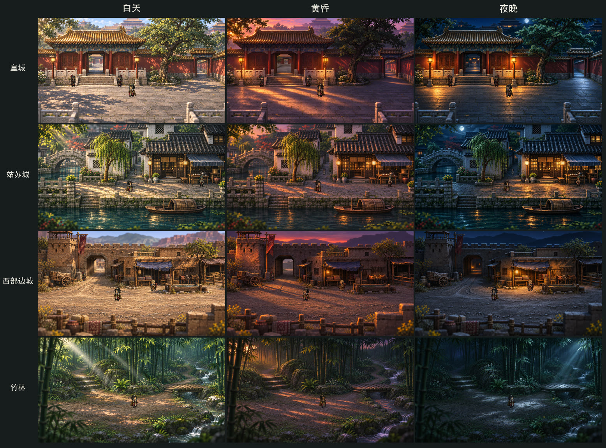
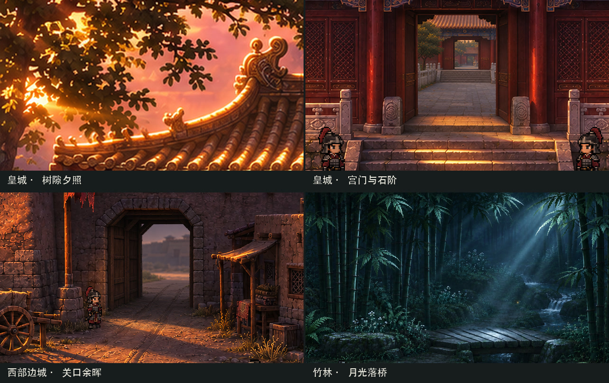

# 武侠四地昼暮夜定稿

从下表打开最接近新委托的完整单幅，作为生成器的画风参考。总览用来选片，局部用来验光。换一个地点时，保留机位、人物与门洞的比例和行走带的清晰度，按实际地形重设路线、材质与光源。

| 地点 | 白天 | 黄昏 | 夜晚 | 适合对照的细节 |
|---|---|---|---|---|
| 皇城 | [御街槐影](皇城·白天.png) | [树隙夕照](皇城·黄昏.png) | [宫灯照阶](皇城·夜晚.png) | 横街可上阶入正门，也可沿朱墙走掖门。檐下朱门处于阴影里，外侧石阶接住暖光。 |
| 姑苏城 | [临河石街](姑苏城·白天.png) | [枫桥晚照](姑苏城·黄昏.png) | [茶窗映水](姑苏城·夜晚.png) | 石街连着桥头和后巷。茶窗与檐灯照到各自门前，水流把倒影切碎，远桥留在冷色里。 |
| 西部边城 | [关前马市](西部边城·白天.png) | [关口余晖](西部边城·黄昏.png) | [驿摊风灯](西部边城·夜晚.png) | 车辙接上城门，摊位给横路让行。落日受土墙遮挡时，门板入暗，关外沙路仍亮。干沙只留漫反射。 |
| 竹林 | [林隙日斑](竹林·白天.png) | [古道斜阳](竹林·黄昏.png) | [月光落桥](竹林·夜晚.png) | 石阶与木桥分别引向林深处。夜里右上竹冠透下少量银蓝月光，溪上薄湿气显出光路，桥板接光。 |

## 跑图距离和人物

对照[峋谷关关内道路](../hd/逸剑风云决/峋谷关/关内道路.jpg)的横纵街口和[程家村村中石阶](../hd/逸剑风云决/程家村/村中石阶.jpg)的上下通路，用人物的行走中心线判断方向。宫城可用横街接正向石阶。山腰驿关则可让关前道路向左展开，到岩肩稍稍放宽，再沿旧木栏缓弯入山。优先保留原有路宽、材质与地势。

四组均为 1672 × 941。皇城、姑苏、边城、竹林的宇文逸可见身高分别约 122、111、119、116 像素，约占画高的 12–13%。这些是本组横街和林道的实测参照。换成近处驿站或室内，把原帧放到实地，用同层门槛、柜台和路人重新定尺。分时段的同一地点复用同一帧、朝向和脚底锚点。

贴回人物后，把双靴与最近一根受同一主光照射的栏桩一起看。栏桩在露天地面留下长影时，人物也应按身高比例从鞋底投出同向长影。已经走进檐下的角色按所在阴影重新判断。

## 从画面判断光能不能这样走

1. **先看入射方向。** 在画面里指明太阳、月亮或灯的位置。光源可以在画外，用屋脊、树冠或石阶的受光侧和投影确认方位。再从光源沿直线看到落点，指出近处哪片叶、哪段墙或哪道檐拦住了光。
2. **分清空气和表面。** 石阶、湿砖或车辙发亮，本身只说明表面受光。只有强光从真实空隙穿过薄雾、水汽或细尘时，才让一小段空气显出丁达尔效应。晴朗黄昏和明月夜都可用，按实际遮挡收束范围。例如皇城只在室外树隙留短暖光，竹林只在溪桥一侧留冷月光。
3. **单独检查门洞。** 分开看露天路面、门槛、门板和檐下空气。暗门框可以衬出远处亮院子。普通房间、城关和门板自身不会发出太阳光或月光。若局部看起来像从门内投下一束射灯，清掉悬空光柱、侧墙亮尘和假亮斑，保留真实受光的地面与台阶。室内若确有窗外强光，从窗外沿窗棂追到室内受光面。
4. **复看缩图和局部。** 先以约 650 像素宽辨主次与投影，再把光源、遮挡边缘和落点放大看。局部修光要检查底图自身是否也有假光源。修完用原尺寸回贴并核对修改范围，再确认人物和其余地标仍对齐。
